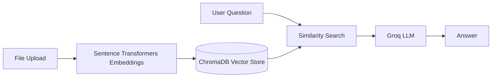

<p align="center">
  
</p>

<h1 align="center">Hi  I'm Siva</h1>

<p align="center">
  🚀 <b>Aspiring GenAI Engineer</b> • 🤖 <b>LLMs &amp; RAG</b> • 🐍 <b>Python</b> • 📊 <b>Data Science</b> • 📱 <b>Flutter</b>
</p>

<p align="center">
  B.Tech Data Science Student at <b>VIT Bhopal</b> | Based in Bhopal, Madhya Pradesh, India
</p>

I am a B.Tech Data Science student at VIT Bhopal, developing my skills in Generative AI. I am passionate about technology, continuous learning, and building practical solutions through data and AI. My goal is to grow into an AI Engineer and contribute to meaningful, real-world projects.

- 🧠 Currently learning **Python**, **Data Structures & Algorithms**, and **AI/ML Engineering**
- 👥 Looking to collaborate on **AI and Generative AI** projects
- ✉️ Contact me at [gudisivasankar875@gmail.com](mailto:gudisivasankar875@gmail.com)

***

## > whoami

```bash
siva@developer:~$ cat Siva.py
```

```python
class Siva:
    def __init__(self):
        self.name = "G Sivashankar"
        self.role = "Data Science Student & Aspiring GenAI Engineer"
        self.university = "VIT Bhopal, India"

        self.currently = (
            "Building RAG-based AI applications and a Flutter agriculture app, "
            "while learning to engineer production-grade GenAI systems."
        )

        self.telemetry = {
            "languages": ["Python", "SQL", "Dart", "JavaScript"],
            "genai": ["LLMs", "RAG", "Groq", "Sentence Transformers"],
            "vector_engines": ["ChromaDB"],
            "backend_core": ["Flask", "SQL Server"],
            "frontend_mobile": ["Flutter", "React", "HTML/CSS"],
        }

        self.focus = [
            "GenAI Engineering",
            "RAG Architectures",
            "Machine Learning",
            "Data Structures & Algorithms",
            "Mobile App Development",
        ]

        self.goal = (
            "Become a GenAI Engineer, build AI products that solve real problems, "
            "and grow my career internationally."
        )

        self.belief = "Start from zero, stay consistent, and build every day."

    def say_hi(self):
        print("Welcome to my GitHub! Building AI, one project at a time 🚀")


me = Siva()
me.say_hi()
```

***

## > current_focus

- 🧠 Building Retrieval-Augmented Generation (**RAG**) applications with **LLMs** and vector databases.
- 📱 Developing **BhoomiQ**, a **Flutter** app for farmers.
- 🐍 Strengthening **Python**, **SQL**, **ML** and **algorithms** fundamentals.

***

## > roadmap

- [x] **Python & SQL** (Basics, Queries, Stored Procedures)
- [x] **Algorithms** (Greedy, Dynamic Programming, Backtracking)
- [x] **RAG Basics** (Embeddings, Vector Search with ChromaDB)
- [ ] **Data Structures & Algorithms** (In Progress)
- [ ] **Machine Learning & Deep Learning**
- [ ] **LLM Agents & Tool Calling**
- [ ] **FastAPI, Docker & Deployment**
- [ ] **Production GenAI Systems**

***

## > tech_stack

<table width="100%">
  <thead>
    <tr>
      <th align="center">💻 Languages</th>
      <th align="center">🤖 AI & Data</th>
      <th align="center">🌐 Backend & Mobile</th>
      <th align="center">🛠️ Tools</th>
    </tr>
  </thead>
  <tbody>
    <tr>
      <td align="center" valign="top">
        <a href="https://skillicons.dev">
          
        </a>
      </td>
      <td align="center" valign="top">
        <a href="https://skillicons.dev">
          
        </a>
      </td>
      <td align="center" valign="top">
        <a href="https://skillicons.dev">
          
        </a>
      </td>
      <td align="center" valign="top">
        <a href="https://skillicons.dev">
          
        </a>
      </td>
    </tr>
  </tbody>
</table>

***

## > github_stats

<div align="center">
  
</div>

<p align="center">
  
  &nbsp;
  
</p>

***

## > contribution_3d

<div align="left">
  
</div>

***

## > projects

`[01]` **NEXUS** — Full-stack AI personal productivity assistant with a RAG pipeline that answers from your own planner and reminder data.



- **Stack**: `Flask` | `ChromaDB` | `Groq` | `Sentence Transformers` | `HTML/JS`

`[02]` **BhoomiQ** (formerly Krishi Mitra) — Flutter mobile app for farmers with OTP login and live weather.
- **Features**: Login and OTP flow, real-time weather using the Open-Meteo API.
- **Stack**: `Flutter` | `Dart` | `Open-Meteo API`

`[03]` **CyberTech AI** — Premium, cinematic website for an AI startup with a 3D hero section and smooth animations.
- **Sections**: Hero, Services, Technology, Projects, About, Contact.
- **Stack**: `React` | `React Three Fiber` | `GSAP` | `Framer Motion`

***

## > contribution_snake

### 🐍 THE CONTRIBUTION SNAKE


<picture>
  <source media="(prefers-color-scheme: dark)" srcset="https://raw.githubusercontent.com/sivashankar875/sivashankar875/output/github-snake-dark.svg" />
  <source media="(prefers-color-scheme: light)" srcset="https://raw.githubusercontent.com/sivashankar875/sivashankar875/output/github-snake.svg" />
  
</picture>

<p align="center">
  🐍 <i>Every commit feeds the snake. Keep building.</i>
</p>

***

## > connect

<p align="center">
  <i>I'm always open to collaborating on AI and Generative AI projects, learning together, or just a good tech conversation.</i>
</p>

<p align="center">
  <a href="https://www.linkedin.com/in/YOUR_LINKEDIN">
    
  </a>
  <a href="mailto:gudisivasankar875@gmail.com">
    
  </a>
  <a href="https://github.com/sivashankar875">
    
  </a>
</p>

<p align="center">
  
</p>
<p align="center">
  <sub>Designed with 💜 by Siva • Last updated 2026 • Open to opportunities</sub>
</p>src="https://raw.githubusercontent.com/danielcranney/readme-generator/main/public/icons/skills/git-colored.svg" alt="Git" title="Git" width="36" height="36" /></a><a href="https://www.python.org/" target="_blank" rel="noreferrer"></a><a href="https://code.visualstudio.com/" target="_blank" rel="noreferrer"></a><a href="https://fastapi.tiangolo.com/" target="_blank" rel="noreferrer"></a><a href="https://www.postgresql.org/" target="_blank" rel="noreferrer"></a><a href="https://cloud.google.com/" target="_blank" rel="noreferrer"></a>
</p>

### Socials

<p align="left"> <a href="https://www.github.com/sivashankar875" target="_blank" rel="noreferrer"> <picture> <source media="(prefers-color-scheme: dark)" srcset="https://raw.githubusercontent.com/danielcranney/readme-generator/main/public/icons/socials/github-dark.svg" /> <source media="(prefers-color-scheme: light)" srcset="https://raw.githubusercontent.com/danielcranney/readme-generator/main/public/icons/socials/github.svg" />  </picture> </a> <a href="https://www.linkedin.com/in/gudi-siva-shankar-59bb55339/" target="_blank" rel="noreferrer"> <picture> <source media="(prefers-color-scheme: dark)" srcset="https://raw.githubusercontent.com/danielcranney/readme-generator/main/public/icons/socials/linkedin-dark.svg" /> <source media="(prefers-color-scheme: light)" srcset="https://raw.githubusercontent.com/danielcranney/readme-generator/main/public/icons/socials/linkedin.svg" />  </picture> </a></p>
<a href="https://www.github.com/sivashankar875" target="_blank" rel="noreferrer"></a>
### Badges

<b>My GitHub Stats</b>

<a href="http://www.github.com/sivashankar875"></a>

<a href="http://www.github.com/sivashankar875"></a>

<a href="https://github.com/sivashankar875" align="left"></a>

<b>Top Repositories</b>

<div width="100%" align="center"></div><br /><br /><br /><br /><br /><br /><br />
