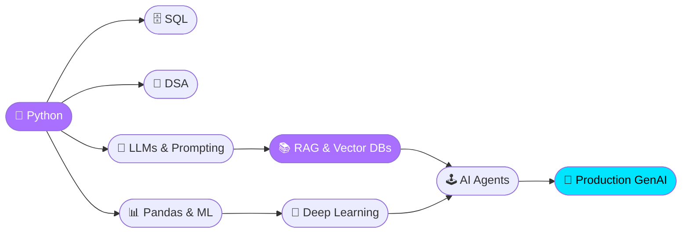
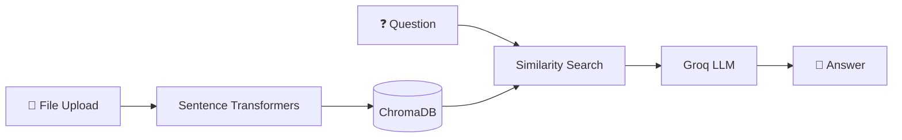

<p align="center">
  
</p>

<p align="center">
  <a href="https://github.com/sivashankar875">
    
  </a>
</p>

<p align="center">
  
  
</p>

***

## 🎮 PLAYER CARD

<table align="center" width="100%">
  <tr>
    <td width="50%" valign="top">

```yaml
PLAYER    : G Sivashankar (Siva)
CLASS     : GenAI Engineer (Apprentice)
GUILD     : VIT Bhopal
LEVEL     : 3  (B.Tech Data Science, 3rd year)
SPAWN     : Bhopal, Madhya Pradesh, India
MAIN QUEST: Become a GenAI Engineer
STATUS    : 🟢 Online, open to collaborate
```

</td>
    <td width="50%" valign="top">

```text
💻 Python      ████████░░  80%
🗄️ SQL         ███████░░░  70%
🧮 Algorithms  ██████░░░░  60%
🧠 RAG / LLMs  █████░░░░░  50%
📱 Flutter     █████░░░░░  50%
🤖 ML / DL     ███░░░░░░░  30%
```
<sub>Self-assessed. I update these as I level up.</sub>

</td>
  </tr>
</table>

***

## 📜 QUEST LOG

| Quest | Type | Status |
|-------|------|--------|
| Become a GenAI Engineer | 🏆 Main quest | ⚔️ In progress |
| Master Data Structures & Algorithms | 🗡️ Side quest | ⚔️ In progress |
| Ship BhoomiQ, a smart farming app | 🗡️ Side quest | ⚔️ In progress |
| Build a premium AI startup website (CyberTech AI) | 🗡️ Side quest | ⚔️ In progress |
| Learn FastAPI, Docker and deployment | 🔒 Locked | Unlocks after ML basics |
| Build an autonomous AI agent | 🔒 Locked | Unlocks after RAG |

***

## 🌳 SKILL TREE



<sub>Purple nodes are the skills I'm actively levelling right now.</sub>

***

## 🎒 INVENTORY

<p align="center">
  
</p>

***

## 👾 BOSS FIGHTS (PROJECTS)

### 🧠 Boss 01: NEXUS
> Full-stack AI personal productivity assistant with a RAG pipeline that answers from your own planner and reminder data.



`Flask` `ChromaDB` `Groq` `Sentence Transformers` `HTML/JS`

### 🌾 Boss 02: BhoomiQ (formerly Krishi Mitra)
> Flutter app for farmers with OTP login and live weather from the Open-Meteo API.

`Flutter` `Dart` `Open-Meteo API`

### 🌌 Boss 03: CyberTech AI
> Premium, cinematic AI startup website with a 3D hero section and smooth animations.

`React` `React Three Fiber` `GSAP` `Framer Motion`

***

## 🕹️ ARCADE ZONE

<p align="center"><b>Pac-Man is eating my contributions</b></p>
<picture>
  <source media="(prefers-color-scheme: dark)" srcset="https://raw.githubusercontent.com/sivashankar875/sivashankar875/pacman-output/pacman-contribution-graph-dark.svg" />
  
</picture>

<br/><br/>

<p align="center">
  
</p>

<p align="center">
  
</p>

<p align="center">
  <picture>
    <source media="(prefers-color-scheme: dark)" srcset="https://raw.githubusercontent.com/sivashankar875/sivashankar875/output/github-snake-cyber.svg" />
    <source media="(prefers-color-scheme: light)" srcset="https://raw.githubusercontent.com/sivashankar875/sivashankar875/output/github-snake.svg" />
    
  </picture>
</p>

<p align="center">
  
  
  
  
  
</p>

<p align="center"><i>🐍 Powered by <a href="https://github.com/Platane/snk">Platane/snk</a> · Auto-updates every 6 hours</i></p>

***

## 📊 STATS

<p align="center">
  
  
</p>

<p align="center">
  
</p>

<p align="center">
  
</p>

## 🏆 ACHIEVEMENTS

<p align="center">
  
</p>

## 🧊 3D CONTRIBUTION WORLD


***

## 🤝 JOIN MY PARTY

<p align="center">
  <i>Looking for teammates on AI and Generative AI projects. Press START and say hi.</i>
</p>

<p align="center">
  <a href="mailto:gudisivasankar875@gmail.com">
    
  </a>
  <a href="https://www.linkedin.com/in/YOUR_LINKEDIN">
    
  </a>
  <a href="https://github.com/sivashankar875?tab=repositories">
    
  </a>
</p>

<p align="center">
  
</p>
<p align="center"><sub>🎮 Game on • Designed by Siva • Last updated 2026</sub></p>
